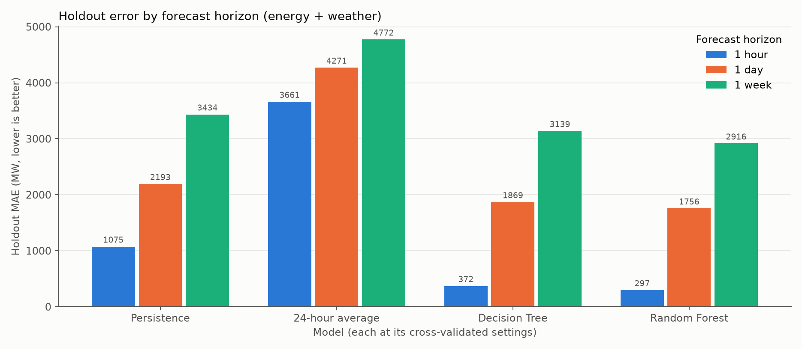
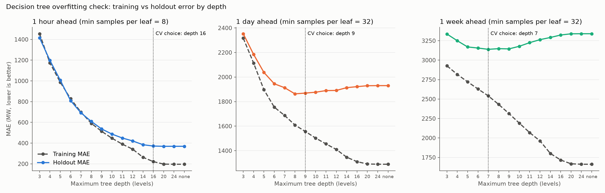
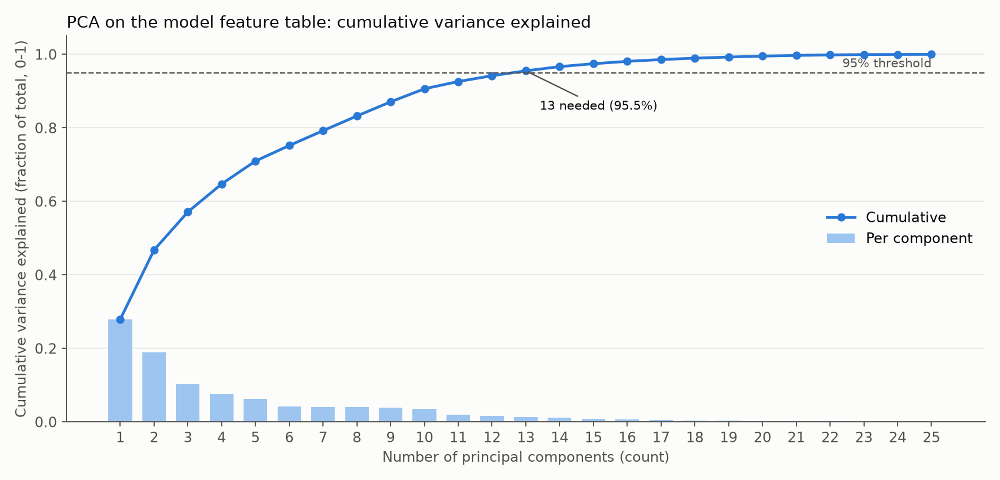
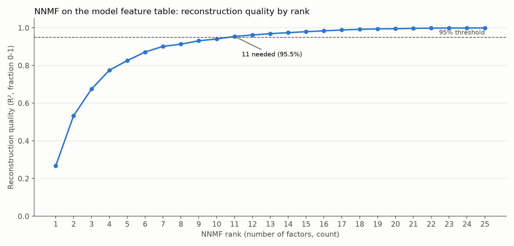
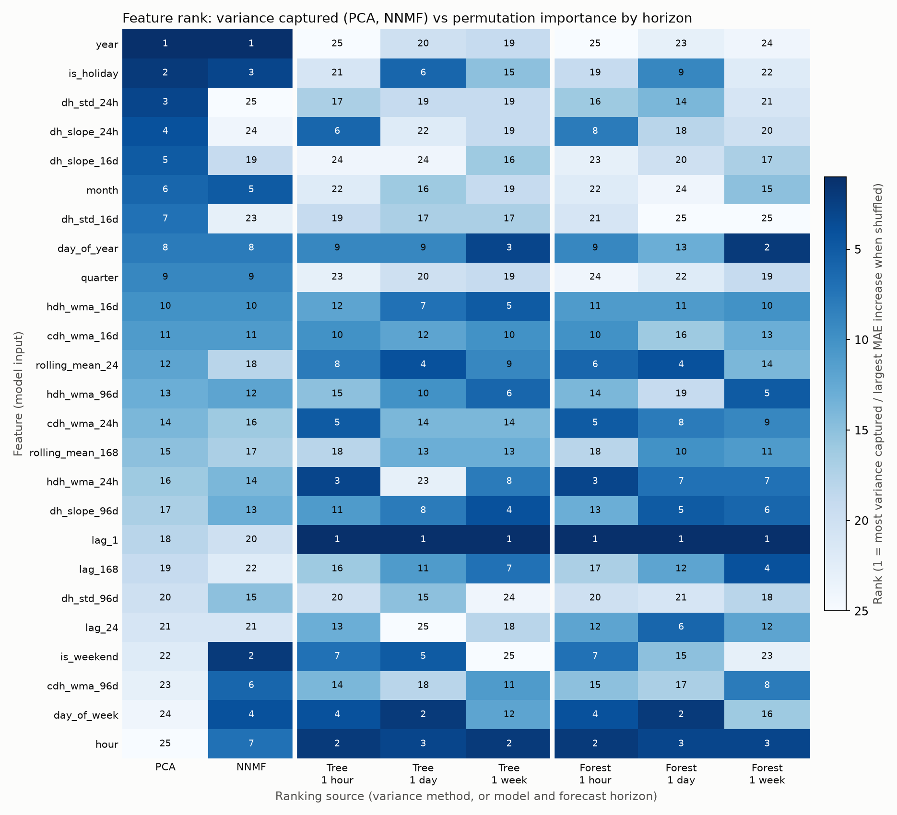
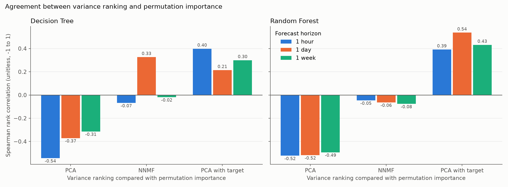
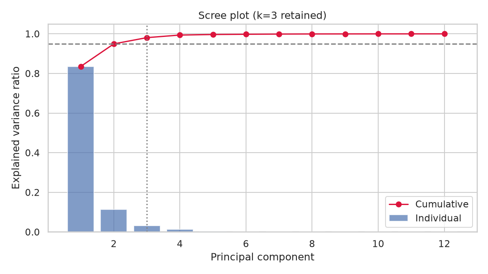
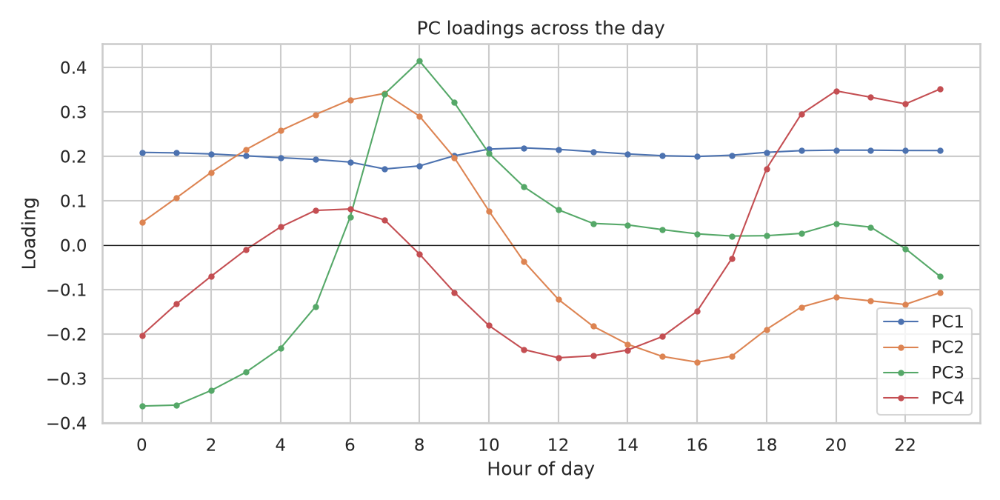
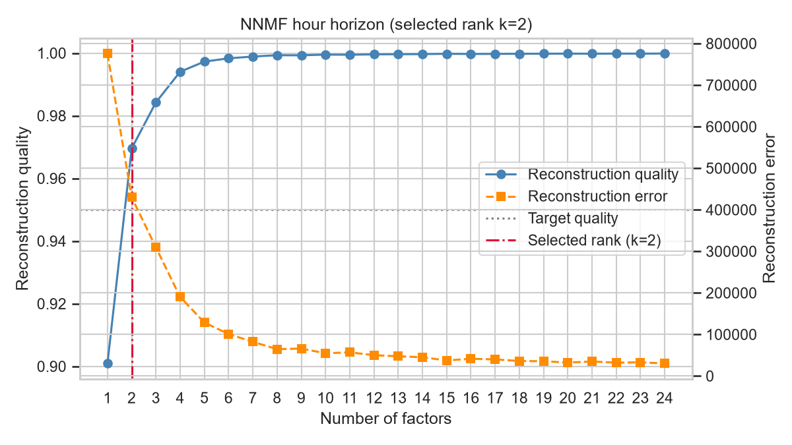
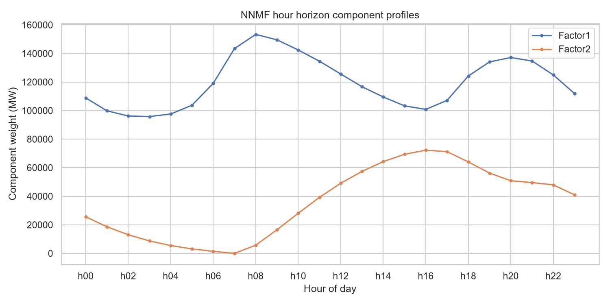

# Forecast Horizons, Feature Importance, and PCA/NNMF Variance

Author: plholt3 · Branch: `peter/final-model-horizons` · Code: `src/energy_forecasting/horizon_experiment.py`

This report extends the final models (decision tree and random forest) from one-hour-ahead
forecasting to **1 hour, 1 day, and 1 week ahead**, tunes each model's depth per horizon with
cross-validation, checks the trees for overfitting, and compares the features each model relies on
with the features that explain the most variance under PCA and NNMF. The team's earlier hourly PCA
and NNMF results are included for reference.

All file names are relative to this file (`reports/horizons/`). Every chart and table names the
CSV it was built from, so it can be recreated. Everything here is regenerated by
`uv run energy-horizons` (see Section 9).

**Units used throughout**

| Quantity | Unit | Meaning |
| --- | --- | --- |
| MAE | MW (megawatts) | Mean absolute error: average size of a forecast miss |
| RMSE | MW | Root mean squared error: like MAE but penalizes large misses more |
| MAPE | % | Mean absolute percentage error: MAE as a percentage of actual load |
| Permutation importance | MW | Increase in holdout MAE when one feature is randomly shuffled |
| Impurity importance | fraction (0–1, sums to 1) | Share of the tree's error reduction from splits on a feature |
| Variance explained / reconstruction quality | fraction (0–1) or % | Share of the data's variance a set of components rebuilds |
| PCA loading | correlation (−1 to 1) | Correlation between a feature and a component |
| NNMF factor share | fraction (0–1, sums to 1 per factor) | Share of a factor made up by each feature |
| Spearman correlation | unitless (−1 to 1) | Agreement between two rankings (1 = identical order, −1 = reversed) |

---

## 1. Method

### 1.1 Forecast horizons (target shift only)

The data pipeline is unchanged. `build_features` produces the same 25 features per hour:

| Group | Features |
| --- | --- |
| Load history | `lag_1`, `lag_24`, `lag_168` (load 1, 24, 168 h before the row, MW); `rolling_mean_24`, `rolling_mean_168` (trailing means, MW) |
| Calendar | `hour`, `day_of_week`, `day_of_year`, `month`, `quarter`, `year`, `is_weekend` (0/1), `is_holiday` (0/1) |
| Weather (population weighted, lagged 1 h) | heating / cooling degree-hour weighted means `hdh_wma_*`, `cdh_wma_*`; degree-hour variability `dh_std_*`; degree-hour trend `dh_slope_*`; each over 24 h, 16 d and 96 d windows |

Each row t holds data observed through hour t − 1. Only the **target** moves:

| Forecast horizon | Row t predicts load at | Target shift (hours) |
| --- | --- | ---: |
| 1 hour ahead | t | 0 (original setup) |
| 1 day ahead | t + 23 | 23 |
| 1 week ahead | t + 167 | 167 |

The shift is done by timestamp, not row position. Because the features stay at the forecast
time, no future information enters a row. After the shift, `lag_1` is still "the latest load known
at forecast time"; relative to the target it is the same hour yesterday (1 day ahead) or the same
hour last week (1 week ahead).

### 1.2 Train / test split

- One chronological split shared by all horizons: **training** 2002-01-01 to 2015-04-28 (about
  114,400 hourly rows), **holdout test** 2015-04-28 15:00 to 2018-08-03 00:00 (about 28,600 rows,
  never used for tuning).
- **Purge:** training rows whose shifted target falls inside the test period are dropped (the last
  23 rows at 1 day ahead, 167 rows at 1 week ahead).

### 1.3 Cross-validation (how depth and other settings were chosen)

- **Expanding-window time-series cross-validation**, `TimeSeriesSplit(n_splits=3, gap=shift)`,
  run on the training period only and repeated separately for each horizon.
- Each fold trains on all earlier rows and validates on the next block of about 28,600 hours
  (about 3.3 years). The **gap** removes the 23 or 167 rows between fit and validation so a
  shifted target can never reach into the validation block.

| Fold | Training rows (1 h / 1 d / 1 wk) | Validation block (1 hour ahead) |
| ---: | --- | --- |
| 1 | 28,619 / 28,591 / 28,411 | 2005-07-12 to 2008-10-16 |
| 2 | 57,236 / 57,202 / 56,986 | 2008-10-16 to 2012-01-22 |
| 3 | 85,853 / 85,813 / 85,561 | 2012-01-22 to 2015-04-28 |

Source: `cv_results.csv` (every candidate × fold, with MAE in MW, RMSE in MW and MAPE in %).

**Search grids**

| Model | Settings searched | Combinations |
| --- | --- | ---: |
| Decision tree | `max_depth` ∈ {3, 4, 5, 6, 7, 8, 9, 10, 11, 12, 14, 16} levels × `min_samples_leaf` ∈ {2, 8, 32} rows | 36 |
| Random forest | Team grid: {150 trees, depth 16, leaf 2, all features}, {200, 20, 2, all}, {200, unlimited, 2, 80%}, {250, 24, 1, 80%} | 4 |

`min_samples_leaf` = the minimum number of training rows a leaf (end node) must contain; larger
values force simpler trees. **Selection rule:** the setting with the lowest mean validation MAE
(MW) across the 3 folds. The chosen model is then refit on the full training period and scored once
on the holdout.

**Selected settings and cross-validation error**

| Forecast horizon | Decision tree: max depth (levels) / min samples per leaf (rows) | Decision tree CV MAE (MW) / MAPE (%) | Random forest settings | Random forest CV MAE (MW) / MAPE (%) |
| --- | --- | --- | --- | --- |
| 1 hour | 16 / 8 | 412.9 / 1.24 | 200 trees, depth 20, leaf 2, all features | 311.4 / 0.93 |
| 1 day | 9 / 32 | 1,786.1 / 5.34 | 200 trees, unlimited depth, leaf 2, 80% features | 1,627.3 / 4.86 |
| 1 week | 7 / 32 | 2,801.8 / 8.44 | 200 trees, unlimited depth, leaf 2, 80% features | 2,528.8 / 7.62 |

Source: `cv_results.csv` (rows with `selected = True`).

### 1.4 Overfitting check

For the decision tree at each horizon, a tree is fit on the full training period at every max
depth (3 to 24 levels and unlimited, using that horizon's selected `min_samples_leaf`) and its
**training error** is compared with its **holdout error**:

- Training error always falls as depth grows (the tree fits its own data more closely).
- If holdout error also keeps falling, the extra depth is capturing real patterns.
- If holdout error stops falling or rises while training error keeps falling, the tree is
  **overfitting**: it is learning noise specific to the training years.

Source: `tree_depth_curve.csv`. Results in Section 2.2.

### 1.5 Model feature importance

For the weather-enabled decision tree and random forest at each horizon:

- **Permutation importance** (primary measure): shuffle one feature in the holdout set (5
  repeats) and record the increase in MAE, in MW.
- **Impurity importance**: scikit-learn `feature_importances_` (fraction, sums to 1); reported for
  comparison because it favors strong continuous features.

### 1.6 PCA and NNMF on the model feature table

To give every feature a variance score that lines up one-to-one with its model importance, PCA and
NNMF are run on **the same 25-column feature table the models use** (weather-enabled training
period; the features are identical at every horizon).

- **PCA:** standardize each column (mean 0, standard deviation 1), keep the components needed for
  95% cumulative variance. A feature's score is its **communality**: the fraction of its variance
  rebuilt by the kept components.
- **NNMF:** min-max scale each column to 0–1 (NMF needs non-negative input), keep the smallest rank
  reaching 95% reconstruction quality (R²), the same rule as Cole's script. A feature's score is
  the R² of its own reconstructed column.
- **PCA with the target (per horizon):** PCA on the 25 features plus the shifted target; a
  feature's score is the absolute correlation with the target as rebuilt from the kept components.
- **Agreement:** Spearman rank correlation between each model's importance ranking and each
  variance ranking.

---

## 2. Model results at their cross-validated depths

### 2.1 Holdout error

All values are on the untouched holdout period (2015-04-28 to 2018-08-03), energy + weather
features. Each cell: **holdout MAE (MW) / MAPE (%)**, then the model's selected settings.
Lower is better; **bold** = best at that horizon.

| Forecast horizon | Decision tree (CV-selected depth) | Random forest (CV-selected depth) | Persistence baseline (last known load) | 24-hour average baseline |
| --- | --- | --- | --- | --- |
| 1 hour ahead | 371.7 MW / 1.17% — depth 16, leaf ≥ 8, 8,307 leaves | **297.4 MW / 0.94%** — depth 20, leaf ≥ 2 | 1,074.8 MW / 3.49% | 3,660.8 MW / 12.05% |
| 1 day ahead | 1,869.3 MW / 5.89% — depth 9, leaf ≥ 32, 387 leaves | **1,755.6 MW / 5.54%** — unlimited depth, leaf ≥ 2 | 2,192.7 MW / 6.94% | 4,271.3 MW / 14.01% |
| 1 week ahead | 3,139.4 MW / 9.94% — depth 7, leaf ≥ 32, 123 leaves | **2,916.0 MW / 9.24%** — unlimited depth, leaf ≥ 2 | 3,434.0 MW / 10.66% | 4,772.2 MW / 15.48% |

Source: `final_model_errors.csv` (also has RMSE in MW, and average leaves per forest tree).
Chart: `mae_by_horizon.png`.



`mae_by_horizon.png` — x axis: model; y axis: holdout MAE (MW, lower is better); bar colour:
forecast horizon. Data: `metrics.csv` (rows with `feature_set = weather_enabled`).

**Improvement over persistence** (percentage reduction in holdout MAE)

| Forecast horizon | Decision tree (%) | Random forest (%) |
| --- | ---: | ---: |
| 1 hour ahead | 65.4 | 72.3 |
| 1 day ahead | 14.7 | 19.9 |
| 1 week ahead | 8.6 | 15.1 |

**Effect of the depth re-tuning on the decision tree** (holdout MAE, MW / MAPE, %)

| Forecast horizon | Team grid (depth 12–16, before) | Wider grid (after) | Change (%) |
| --- | --- | --- | ---: |
| 1 hour ahead | 380.0 / 1.20 (depth 16, leaf 4) | 371.7 / 1.17 (depth 16, leaf 8) | −2.2 |
| 1 day ahead | 1,988.8 / 6.21 (depth 12, leaf 2) | 1,869.3 / 5.89 (depth 9, leaf 32) | −6.0 |
| 1 week ahead | 3,380.6 / 10.59 (depth 12, leaf 2) | 3,139.4 / 9.94 (depth 7, leaf 32) | −7.1 |

The random forest's settings and errors are unchanged by the re-tuning.

### 2.2 Overfitting check



`tree_depth_curve.png` — x axis: maximum tree depth (levels); y axis: MAE (MW, lower is better);
dashed grey = training MAE, solid = holdout MAE; dotted vertical line = cross-validation choice.
Data: `tree_depth_curve.csv`.

**1 hour ahead** (min samples per leaf = 8; 114,470 training rows)

| Max depth (levels) | Training MAE (MW) | Holdout MAE (MW) | Gap: holdout − training (MW) | Training MAPE (%) | Holdout MAPE (%) | Number of leaves | Avg training rows per leaf |
| ---: | ---: | ---: | ---: | ---: | ---: | ---: | ---: |
| 8 | 590.6 | 609.1 | 18.6 | 1.81 | 1.96 | 253 | 452 |
| 10 | 446.9 | 486.9 | 40.0 | 1.36 | 1.55 | 927 | 123 |
| 12 | 341.7 | 421.1 | 79.4 | 1.03 | 1.33 | 2,821 | 41 |
| 14 | 263.3 | 384.5 | 121.2 | 0.79 | 1.21 | 5,769 | 20 |
| **16 (selected)** | **221.5** | **371.7** | **150.2** | **0.67** | **1.17** | **8,307** | **14** |
| 20 | 197.5 | 369.2 | 171.7 | 0.60 | 1.17 | 10,912 | 10 |
| unlimited | 196.1 | 369.3 | 173.2 | 0.59 | 1.17 | 11,213 | 10 |

**1 day ahead** (min samples per leaf = 32)

| Max depth (levels) | Training MAE (MW) | Holdout MAE (MW) | Gap (MW) | Training MAPE (%) | Holdout MAPE (%) | Number of leaves |
| ---: | ---: | ---: | ---: | ---: | ---: | ---: |
| 4 | 2,114.1 | 2,184.5 | 70.3 | 6.55 | 7.04 | 16 |
| 6 | 1,754.7 | 1,945.1 | 190.4 | 5.36 | 6.17 | 64 |
| 8 | 1,609.0 | 1,863.0 | 254.0 | 4.91 | 5.89 | 225 |
| **9 (selected)** | **1,556.6** | **1,869.3** | **312.8** | **4.75** | **5.89** | **387** |
| 10 | 1,502.5 | 1,876.4 | 373.8 | 4.58 | 5.90 | 608 |
| 12 | 1,409.9 | 1,890.9 | 481.0 | 4.29 | 5.93 | 1,208 |
| 16 | 1,310.5 | 1,921.7 | 611.2 | 3.98 | 6.02 | 2,345 |
| unlimited | 1,289.4 | 1,930.1 | 640.6 | 3.92 | 6.05 | 2,751 |

**1 week ahead** (min samples per leaf = 32)

| Max depth (levels) | Training MAE (MW) | Holdout MAE (MW) | Gap (MW) | Training MAPE (%) | Holdout MAPE (%) | Number of leaves |
| ---: | ---: | ---: | ---: | ---: | ---: | ---: |
| 4 | 2,817.2 | 3,249.7 | 432.5 | 8.57 | 10.29 | 16 |
| 6 | 2,629.9 | 3,155.9 | 525.9 | 7.98 | 9.97 | 64 |
| **7 (selected)** | **2,541.0** | **3,139.4** | **598.4** | **7.72** | **9.94** | **123** |
| 8 | 2,431.3 | 3,148.1 | 716.7 | 7.39 | 9.97 | 223 |
| 12 | 1,962.2 | 3,263.8 | 1,301.6 | 5.99 | 10.24 | 1,178 |
| 16 | 1,716.7 | 3,323.4 | 1,606.7 | 5.25 | 10.42 | 2,263 |
| unlimited | 1,662.3 | 3,339.8 | 1,677.5 | 5.08 | 10.48 | 2,724 |

**Reasoning**

- **1 hour ahead — partly overfit, but not harmful.** At depth 16 the tree's training error is
  about 40% lower than its holdout error (0.67% vs 1.17% MAPE), so it fits its own data more
  closely than it generalizes. But holdout error keeps improving all the way to depth 16
  (1.96% → 1.17% MAPE from depth 8) and then levels off; it never gets worse. Harmful overfitting
  would show holdout error rising. The many leaves are needed because one-hour-ahead load is an
  almost smooth function of `lag_1`, and a tree can only approximate a smooth curve with many small
  steps; with 114,470 training rows each leaf still averages 14 rows (minimum 8), so it is not
  memorizing single hours. **Simpler alternative:** depth 12 has about one third of the leaves
  (2,821) and half the gap (79.4 MW) for 49.4 MW (0.16 percentage points) more holdout error.
- **1 day ahead — real overfitting past depth 8.** Training error keeps falling while holdout error
  bottoms out at depth 8–9 (5.89% MAPE) and then rises (6.05% unlimited). Cross-validation chose
  depth 9, at the turning point; the old depth-12 tree was past it.
- **1 week ahead — real overfitting past about depth 8.** Holdout error is flat from depth 6 to 9
  (9.93–9.97% MAPE) and rises after; cross-validation chose depth 7. Even the 16-leaf tree has a
  432.5 MW gap, which mostly reflects the test years differing from the training years (load and
  weather drift), not overfitting.
- **Cross-validation and the holdout agree**: the CV-selected depths are at or next to the depth
  with the lowest holdout error at every horizon, so the depth choice did not need the holdout.
- **Random forest:** not depth-checked the same way; averaging 200 trees controls overfitting, and
  in cross-validation all four forest settings were within about 2% of each other at every horizon
  (`cv_results.csv`).

---

## 3. PCA and NNMF on the model feature table

### 3.1 Cumulative variance



`pca_cumulative_variance.png` — x axis: number of principal components (count); y axis: cumulative
variance explained (fraction of total, 0–1); bars: variance explained by each component (fraction);
dashed line: 95% threshold. Data: `pca_cumulative_variance.csv`.



`nnmf_rank_quality.png` — x axis: NNMF rank (number of factors, count); y axis: reconstruction
quality (R², fraction 0–1); dashed line: 95% threshold. Data: `nnmf_rank_quality.csv`.

| Method | Components kept (count) | Variance explained / quality at that size (%) | First component (%) |
| --- | ---: | ---: | --- |
| PCA | 13 of 25 | 95.5 | PC1 27.9, PC2 18.9, PC3 10.4 |
| NNMF | 11 of 25 | 95.5 | rank 1 alone: 26.7; rank 2: 53.4 |

Source: `variance_settings.json`, `pca_cumulative_variance.csv`, `nnmf_rank_quality.csv`.

Unlike the hourly load profiles (Section 6), the 25 model features do not compress well: about half
the components are needed for 95%, because the features measure different things (load level,
time, temperature, variability). NNMF rank 1 hit the 1,000-iteration limit (convergence warning);
ranks 2 and up converged.

### 3.2 What each PCA component is made of

Loadings are correlations (−1 to 1) between each standardized feature and the component; listed are
features with |loading| ≥ 0.40 (or the top 3 when fewer reach 0.40). The sign shows direction:
features with opposite signs move in opposite directions along that component.

| Component | Variance explained (%) | Cumulative (%) | Main features (loading, correlation −1 to 1) | Interpretation |
| --- | ---: | ---: | --- | --- |
| PC1 | 27.9 | 27.9 | hdh_wma_96d +0.94, cdh_wma_96d −0.90, hdh_wma_16d +0.85, cdh_wma_16d −0.84, dh_std_96d +0.83, cdh_wma_24h −0.77, hdh_wma_24h +0.77, quarter −0.62, dh_std_16d +0.61, month −0.61, day_of_year −0.60 | Season / temperature: heating (winter, +) vs cooling (summer, −) |
| PC2 | 18.9 | 46.8 | lag_1 +0.83, lag_24 +0.82, rolling_mean_24 +0.81, rolling_mean_168 +0.78, lag_168 +0.74, dh_slope_96d +0.55 | Recent load level |
| PC3 | 10.4 | 57.1 | day_of_year +0.67, month +0.66, quarter +0.65, dh_slope_96d +0.59, hdh_wma_24h +0.46 | Position in the calendar year |
| PC4 | 7.6 | 64.7 | day_of_week +0.88, is_weekend +0.87, rolling_mean_168 +0.26 | Weekly cycle (weekday vs weekend) |
| PC5 | 6.2 | 71.0 | hour +0.82, lag_168 +0.34, lag_24 +0.33 | Time of day |
| PC6 | 4.2 | 75.2 | dh_slope_24h +0.91, dh_slope_16d −0.36, year +0.15 | 24-hour temperature trend |
| PC7 | 4.0 | 79.2 | dh_std_24h +0.75, dh_slope_16d +0.40, year +0.32 | 24-hour temperature variability |
| PC8 | 4.0 | 83.2 | year +0.87, dh_slope_24h −0.25, is_holiday +0.23 | Long-term year trend |
| PC9 | 3.9 | 87.1 | is_holiday +0.91, year −0.25, is_weekend +0.17 | Holidays |
| PC10 | 3.5 | 90.6 | dh_slope_16d +0.60, dh_std_24h −0.52, dh_slope_24h +0.28 | 16-day temperature trend |
| PC11 | 2.0 | 92.6 | dh_std_96d +0.34, cdh_wma_96d −0.21, rolling_mean_24 +0.21 | Weak mixture (no loading ≥ 0.40) |
| PC12 | 1.6 | 94.2 | dh_std_16d +0.52, dh_slope_96d −0.13, hdh_wma_24h −0.13 | 16-day temperature variability |
| PC13 | 1.3 | 95.5 | lag_168 +0.30, dh_std_96d +0.28, rolling_mean_168 +0.18 | Weak mixture (no loading ≥ 0.40) |

Source: `pca_components.csv` (full 25 features × 13 components loading matrix) and
`pca_cumulative_variance.csv`.

### 3.3 What each NNMF factor is made of

Factor shares are each factor's weights normalized to sum to 1 (fraction of the factor contributed by
each min-max-scaled feature); listed are features with share ≥ 0.08 (or the top 3). NNMF factors are
additive (no negative weights), so each factor is a group of features that are high together.

| Factor | Main features (share of factor, fraction 0–1) | Interpretation |
| --- | --- | --- |
| Factor 1 | quarter 0.26, month 0.23, day_of_year 0.22 | Calendar season (late in year) |
| Factor 2 | dh_std_96d 0.29, hdh_wma_96d 0.24, dh_slope_24h 0.13, dh_std_16d 0.08 | Winter heating and long-window temperature variability |
| Factor 3 | is_weekend 0.47, day_of_week 0.39, hour 0.06 | Weekends |
| Factor 4 | cdh_wma_96d 0.25, quarter 0.13, dh_slope_96d 0.12, month 0.11, day_of_year 0.11, dh_slope_24h 0.09 | Summer cooling season |
| Factor 5 | hour 0.54, lag_1 0.14, lag_168 0.14, lag_24 0.14 | Time of day with load level |
| Factor 6 | year 0.89, dh_slope_16d 0.06, dh_std_24h 0.02 | Year trend |
| Factor 7 | dh_slope_96d 0.21, hdh_wma_16d 0.16, hdh_wma_24h 0.12, dh_std_16d 0.10, rolling_mean_168 0.10 | Short / mid-window heating and warming trend |
| Factor 8 | day_of_week 0.68, rolling_mean_24 0.09, lag_24 0.08 | Late-week days |
| Factor 9 | is_holiday 0.75, dh_slope_16d 0.07, hour 0.05 | Holidays |
| Factor 10 | dh_slope_16d 0.35, hdh_wma_24h 0.12, rolling_mean_24 0.11, dh_slope_24h 0.10, lag_1 0.08 | 16-day temperature trend |
| Factor 11 | cdh_wma_16d 0.11, rolling_mean_24 0.11, rolling_mean_168 0.11, cdh_wma_24h 0.10 (spread evenly) | Diffuse: summer cooling with load averages |

Source: `nnmf_components.csv` (full 25 features × 11 factors share matrix).

### 3.4 Variance captured per feature

| Feature | PCA variance captured (fraction 0–1) | PCA rank (1 = most) | NNMF variance captured (R², fraction 0–1) | NNMF rank (1 = most) |
| --- | ---: | ---: | ---: | ---: |
| year | 1.000 | 1 | 1.000 | 1 |
| is_holiday | 0.999 | 2 | 0.999 | 3 |
| dh_std_24h | 0.997 | 3 | 0.125 | 25 |
| dh_slope_24h | 0.996 | 4 | 0.141 | 24 |
| dh_slope_16d | 0.995 | 5 | 0.869 | 19 |
| month | 0.991 | 6 | 0.987 | 5 |
| dh_std_16d | 0.991 | 7 | 0.625 | 23 |
| day_of_year | 0.989 | 8 | 0.984 | 8 |
| quarter | 0.974 | 9 | 0.980 | 9 |
| hdh_wma_16d | 0.974 | 10 | 0.975 | 10 |
| cdh_wma_16d | 0.970 | 11 | 0.963 | 11 |
| rolling_mean_24 | 0.965 | 12 | 0.881 | 18 |
| hdh_wma_96d | 0.957 | 13 | 0.962 | 12 |
| cdh_wma_24h | 0.941 | 14 | 0.902 | 16 |
| rolling_mean_168 | 0.941 | 15 | 0.890 | 17 |
| hdh_wma_24h | 0.938 | 16 | 0.916 | 14 |
| dh_slope_96d | 0.938 | 17 | 0.931 | 13 |
| lag_1 | 0.935 | 18 | 0.823 | 20 |
| lag_168 | 0.934 | 19 | 0.699 | 22 |
| dh_std_96d | 0.931 | 20 | 0.906 | 15 |
| lag_24 | 0.919 | 21 | 0.806 | 21 |
| is_weekend | 0.908 | 22 | 1.000 | 2 |
| cdh_wma_96d | 0.901 | 23 | 0.986 | 6 |
| day_of_week | 0.900 | 24 | 0.999 | 4 |
| hour | 0.896 | 25 | 0.984 | 7 |

Source: `variance_ranking.csv`. Caution: with 13 components kept, every PCA score is between 0.90
and 1.00, so the PCA ranking rests on small differences; NNMF scores spread from 0.13 to 1.00.

---

## 4. Variance vs predictive features

### 4.1 Side by side

Each column ranks the 25 features by its own measure (row 1 = top). Values in brackets: **PCA and
NNMF columns = variance captured (fraction 0–1); model columns = permutation importance (MW increase
in holdout MAE when the feature is shuffled)**. Decision trees and random forests are at their
cross-validated settings (Section 2.1).

| Rank | PCA (fraction) | NNMF (fraction) | Decision tree 1 hour (MW) | Decision tree 1 day (MW) | Decision tree 1 week (MW) | Random forest 1 hour (MW) | Random forest 1 day (MW) | Random forest 1 week (MW) |
| ---: | --- | --- | --- | --- | --- | --- | --- | --- |
| 1 | year (1.000) | year (1.000) | lag_1 (6,418) | lag_1 (4,793) | lag_1 (2,314) | lag_1 (6,529) | lag_1 (4,678) | lag_1 (1,875) |
| 2 | is_holiday (0.999) | is_weekend (1.000) | hour (1,180) | day_of_week (680) | hour (152) | hour (1,180) | day_of_week (603) | day_of_year (238) |
| 3 | dh_std_24h (0.997) | is_holiday (0.999) | hdh_wma_24h (87) | hour (350) | day_of_year (140) | hdh_wma_24h (64) | hour (334) | hour (147) |
| 4 | dh_slope_24h (0.996) | day_of_week (0.999) | day_of_week (64) | rolling_mean_24 (130) | dh_slope_96d (122) | day_of_week (39) | rolling_mean_24 (121) | lag_168 (131) |
| 5 | dh_slope_16d (0.995) | month (0.987) | cdh_wma_24h (44) | is_weekend (29) | hdh_wma_16d (109) | cdh_wma_24h (35) | dh_slope_96d (43) | hdh_wma_96d (108) |
| 6 | month (0.991) | cdh_wma_96d (0.986) | dh_slope_24h (28) | is_holiday (20) | hdh_wma_96d (100) | rolling_mean_24 (31) | lag_24 (37) | dh_slope_96d (82) |
| 7 | dh_std_16d (0.991) | hour (0.984) | is_weekend (28) | hdh_wma_16d (13) | lag_168 (95) | is_weekend (31) | hdh_wma_24h (27) | hdh_wma_24h (53) |
| 8 | day_of_year (0.989) | day_of_year (0.984) | rolling_mean_24 (28) | dh_slope_96d (12) | hdh_wma_24h (26) | dh_slope_24h (29) | cdh_wma_24h (22) | cdh_wma_96d (45) |
| 9 | quarter (0.974) | quarter (0.980) | day_of_year (24) | day_of_year (10) | rolling_mean_24 (20) | day_of_year (15) | is_holiday (19) | cdh_wma_24h (45) |
| 10 | hdh_wma_16d (0.974) | hdh_wma_16d (0.975) | cdh_wma_16d (19) | hdh_wma_96d (6) | cdh_wma_16d (18) | cdh_wma_16d (11) | rolling_mean_168 (17) | hdh_wma_16d (38) |

Source: `feature_rank_side_by_side.csv` (all 25 ranks). Full values: `variance_ranking.csv` and
`feature_importance.csv` (permutation mean and standard deviation in MW, impurity importance as a
fraction, for every feature × model × horizon).

**Share of permutation importance carried by `lag_1`** (percentage of the total positive MAE
increase across all 25 features)

| Model | 1 hour ahead (%) | 1 day ahead (%) | 1 week ahead (%) |
| --- | ---: | ---: | ---: |
| Decision tree | 80.3 | 78.9 | 74.0 |
| Random forest | 81.5 | 78.1 | 64.4 |

Impurity importance of `lag_1` (fraction 0–1): decision tree 0.95 / 0.89 / 0.86, random forest
0.95 / 0.72 / 0.55. Source: `feature_importance.csv`.



`rank_heatmap.png` — y axis: feature (model input); x axis: ranking source (PCA, NNMF, or model and
forecast horizon); cell value and colour: rank (1 = most variance captured / largest MAE increase
when shuffled; 25 = least). Data: `variance_ranking.csv`, `feature_importance.csv`.

### 4.2 Agreement between the rankings



`rank_agreement.png` — x axis: variance ranking compared with permutation importance; y axis:
Spearman rank correlation (unitless, −1 to 1); bar colour: forecast horizon. Data:
`rank_agreement.csv`.

**Spearman rank correlation with permutation importance** (unitless, −1 to 1; p-value in brackets)

| Model | Forecast horizon | vs PCA variance | vs NNMF variance | vs PCA with target |
| --- | --- | ---: | ---: | ---: |
| Decision tree | 1 hour | −0.54 (0.005) | −0.07 (0.75) | 0.40 (0.05) |
| Decision tree | 1 day | −0.37 (0.07) | 0.33 (0.11) | 0.21 (0.31) |
| Decision tree | 1 week | −0.31 (0.13) | −0.02 (0.93) | 0.30 (0.15) |
| Random forest | 1 hour | −0.52 (0.007) | −0.05 (0.83) | 0.39 (0.05) |
| Random forest | 1 day | −0.52 (0.008) | −0.06 (0.76) | 0.54 (0.006) |
| Random forest | 1 week | −0.49 (0.01) | −0.08 (0.72) | 0.43 (0.03) |

With impurity importance instead: PCA −0.38 to −0.50, NNMF −0.36 to 0.22, PCA with target 0.30 to
0.69 (`rank_agreement.csv`).

**PCA with the shifted target** — features most aligned with future load (absolute correlation
with the target as rebuilt from the kept components, unitless 0–1)

| Forecast horizon | Top 5 features (alignment, 0–1) | Target variance captured (%) |
| --- | --- | ---: |
| 1 hour | lag_1 0.96, lag_24 0.90, lag_168 0.78, rolling_mean_24 0.72, rolling_mean_168 0.57 | 95.8 |
| 1 day | lag_1 0.89, lag_24 0.75, lag_168 0.70, rolling_mean_24 0.56, hour 0.54 | 94.5 |
| 1 week | lag_1 0.81, lag_168 0.79, lag_24 0.77, rolling_mean_24 0.46, hour 0.45 | 93.2 |

Source: `target_alignment.csv`, `variance_settings.json`.

### 4.3 Why the variance features differ from the predictive features

1. **PCA and NNMF never see the target.** They rank features by how much the inputs vary and
   co-vary with each other, not by how much they say about future load. Spearman correlation with
   model importance is **negative for PCA at every model and horizon** (−0.31 to −0.54) and about
   zero for NNMF (−0.08 to 0.33, none significant).
2. **Features that get a component to themselves score highest.** `year` (PC8, Factor 6),
   `is_holiday` (PC9, Factor 9), `dh_slope_24h` (PC6) and `dh_std_24h` (PC7) are each nearly the only
   feature on their own component, so the kept components rebuild them almost perfectly. Yet the
   models barely use them: `year` ranks 19th–25th for every model because trees cannot extrapolate
   a trend into new test years, and holidays are rare.
3. **The predictive features are redundant with each other, so PCA spreads them out.** `lag_1`,
   `lag_24`, `lag_168`, `rolling_mean_24` and `rolling_mean_168` all load on one component (PC2,
   18.9% of variance). Because they share it, each one's individual variance score is only middling
   (`lag_1` ranks 18th of 25). The models need only one of them, `lag_1`, which ranks 1st for every
   model at every horizon and carries 64–82% of permutation importance.
4. **NNMF favours bounded calendar features.** After min-max scaling, `is_weekend`, `day_of_week`,
   `hour`, `month` and `day_of_year` sit on clean 0–1 grids that NNMF rebuilds almost exactly
   (R² ≥ 0.98), while short-window temperature variability (`dh_std_24h` 0.13, `dh_slope_24h` 0.14)
   is rebuilt poorly. This puts calendar features near the top of NNMF's ranking even though
   only `hour`, `day_of_week` and `day_of_year` matter to the models, and only at specific horizons.
5. **Adding the target makes PCA point at the predictive features.** With the shifted target in the
   table, the load-history block aligns with future load (`lag_1` 0.96 / 0.89 / 0.81) and agreement
   with the models turns positive (0.21 to 0.54).
6. **The models' second-tier features move with the horizon; the variance ranking cannot.** The
   variance side is one fixed ranking. The models' ranking changes:
   - **1 hour:** recent load, then time of day (`hour`) and 24-hour weather.
   - **1 day:** the weekly cycle moves up (`day_of_week` 2nd), with `hour` and `rolling_mean_24`.
   - **1 week:** seasonal information moves up (`day_of_year` 2nd–3rd), with long-window weather
     (`hdh_wma_96d`, `hdh_wma_16d`, `dh_slope_96d`) and `lag_168`.

   The components that describe these patterns do exist (PC4 / Factor 3 weekly cycle, PC5 /
   Factor 5 time of day, PC1 / PC3 / Factors 1, 2, 4 season), but PCA and NNMF give them no extra
   weight at the horizons where they matter, because they do not know the horizon.

**Takeaway:** the features that explain the most variance in the inputs are not the features that
predict load. Unsupervised PCA and NNMF describe the structure of the data (season, load level,
weekly cycle, time of day), and the models use a few of those structures, but which ones matter
depends on the forecast horizon, which only a supervised view (the models, or PCA with the target)
can reveal.

---

## 5. Weather (brief)

Weather uses only observations before the forecast time at every horizon. Random forest holdout MAE
with vs without weather: 297.4 vs 305.5 MW at 1 hour (−2.7%), 1,755.6 vs 1,786.2 MW at 1 day
(−1.7%), 2,916.0 vs 2,915.7 MW at 1 week (0.0%). Source: `metrics.csv`.

---

## 6. Earlier hourly PCA and NNMF (team results on `main`)

These run PCA / NNMF on **load reshaped into daily profiles** (one row per day, 24 hourly columns).
They describe the shape of daily load; they are not linked to any forecast horizon.

### 6.1 PCA, daily profiles (Thomas, `src/PCA/pca.py`)

6,057 days × 24 hours, each hour column standardized.

| Component | Variance explained (%) | Cumulative (%) | Shape (loading across hours, correlation −1 to 1) |
| --- | ---: | ---: | --- |
| PC1 | 83.5 | 83.5 | Flat across all hours (0.17–0.22): **overall daily load level** |
| PC2 | 11.4 | 94.9 | Positive 01:00–09:00 (peak +0.34 at 07:00), negative 11:00–23:00 (lowest −0.26 at 16:00): **morning vs afternoon**, winter-type vs summer-type day |
| PC3 | 3.2 | 98.1 | Peak 07:00–09:00 (+0.41 at 08:00), negative overnight (−0.36): **morning ramp**, weekday vs weekend |

3 components reach 95% (98.1%). PC1 tracks daily mean load (r = 1.00), PC2 tracks winter (+0.58)
vs summer (−0.55), PC3 tracks weekends (−0.81). Variance figures computed from
`../pca/daily/pc_scores.csv`; loadings from `../pca/daily/pc_loadings.csv`.



`../pca/daily/01_scree.png` — data: `../pca/daily/pc_scores.csv`.



`../pca/daily/02_loadings_lines.png` — x axis: hour of day (0–23); y axis: loading (correlation).
Data: `../pca/daily/pc_loadings.csv`.

Other files: `../pca/daily/03_loadings_heatmap.png`, `04_score_scatter.png`,
`05_scores_timeseries.png`. Weekly and monthly versions (168 hourly slots per row) are in
`../pca/weekly/` (6 PCs for 95%; PC1 67.5%) and `../pca/monthly/` (4 PCs for 95%; PC1 78.8%); EDA
charts are `../pca/eda_01` to `eda_05` with `../pca/eda_dow_summary.csv` and
`../pca/eda_weekday_weekend_hourly.csv`.

### 6.2 NNMF, hourly profiles (Cole, `src/NNMF/nnmf.py`, "hour" setting)

6,057 days × 24 hours, globally min-max scaled.

| Rank (factors) | Reconstruction quality (%) |
| ---: | ---: |
| 1 | 90.1 |
| **2 (selected)** | **97.0** |
| 3 | 98.4 |

| Factor | Shape (component weight, MW) | Linked to |
| --- | --- | --- |
| Factor 1 | Morning peak ~153,000 at 08:00 and evening peak ~137,000 at 20:00, trough ~101,000 at 16:00 | Winter-type day (r = 0.52 with winter) |
| Factor 2 | Near 0 at 07:00, rising through the day to a peak ~72,000 at 16:00 | Summer-type day (r = 0.74 with summer) |

Source: `../nnmf/hour/nnmf_summary.csv`, `nnmf_rank_metrics.csv`, `nnmf_components.csv`,
`nnmf_scores.csv`.



`../nnmf/hour/01_rank_selection.png` — data: `../nnmf/hour/nnmf_rank_metrics.csv`.



`../nnmf/hour/02_component_profiles.png` — x axis: hour of day; y axis: component weight (MW).
Data: `../nnmf/hour/nnmf_components.csv`.

Other files: `../nnmf/hour/03_components_heatmap.png`, `04_activation_scatter.png`,
`05_activation_timeseries.png`, `06_top_factors.png`. The "day" (7 days per week, rank 3, 96.2%) and
"week" (365 days per year, rank 12, 95.3%, only 16 rows) versions are in `../nnmf/day/` and
`../nnmf/week/`.

### 6.3 How the hourly results relate to this report

The hourly PCA / NNMF show that daily load is mostly one overall level plus a winter-vs-summer
shape, consistent with `lag_1` (level) and `hour` (daily shape) leading the 1-hour models. Their
columns are hours of the day, not model features, so they cannot be ranked against model
importance directly; Section 3 reruns PCA / NNMF on the model feature table for that purpose.

---

## 7. What we do and do not have

### Have

| Item | Where |
| --- | --- |
| Decision tree and random forest error at 1 h, 1 day, 1 week at cross-validated settings, plus both baselines | `final_model_errors.csv`, `metrics.csv`, `mae_by_horizon.png` |
| Cross-validation results for every candidate and fold (36 tree, 4 forest settings per horizon) | `cv_results.csv` |
| Decision tree overfitting check (training vs holdout by depth, MW and %) | `tree_depth_curve.csv`, `tree_depth_curve.png` |
| Impurity and permutation importance, every feature × model × horizon | `feature_importance.csv`, `rank_heatmap.png` |
| PCA cumulative variance and NNMF quality by rank on the model feature table | `pca_cumulative_variance.*`, `nnmf_rank_quality.*` |
| Makeup of every kept PCA component and NNMF factor | `pca_components.csv`, `nnmf_components.csv` |
| Per-feature variance captured (PCA, NNMF) and side-by-side ranking | `variance_ranking.csv`, `feature_rank_side_by_side.csv` |
| PCA with the shifted target, per horizon | `target_alignment.csv` |
| Spearman agreement, all combinations, with p-values | `rank_agreement.csv`, `rank_agreement.png` |
| Earlier hourly / weekly / monthly PCA and hour / day / week NNMF | `../pca/`, `../nnmf/` |
| Original 1-hour final model results (unchanged) | `../final/` |
| Auto-generated run summary (overwritten each run) | `summary.md` |

### Do not have

| Missing | Why it matters |
| --- | --- |
| Feature importance for the energy-only models | Only weather-enabled importances were computed; energy-only has error metrics only. |
| NNMF with the target included | Only PCA was run with the shifted target. |
| Separate tuning for the energy-only feature set | Both feature sets use settings tuned on weather-enabled data. |
| Target-time calendar features | `is_weekend` and `is_holiday` describe the forecast hour, not the target hour. |
| Weather forecasts | Weather uses only observations before the forecast time; a real day-ahead system would also have forecast weather. |
| Uncertainty across splits | One holdout period (2015-04 to 2018-08); no repeated splits or confidence intervals. |
| Hourly PCA / NNMF tied to horizons | Thomas's and Cole's analyses describe load shapes only. |
| Cost-complexity pruning (`ccp_alpha`) | Tree size is limited by depth and minimum samples per leaf only; no post-pruning was tested. |

## 8. Caveats

- `hour` and `day_of_week` are numeric codes, so PCA / NNMF treat 23:00 and 00:00 as far apart;
  cyclic encodings would change their variance scores.
- `year` is a steady trend and `is_holiday` a rare 0/1 flag; both rank high for variance partly
  because of how they are encoded.
- Permutation importance splits credit between correlated features (e.g. `lag_1` and
  `rolling_mean_24`), so a feature's importance can understate what it carries jointly.
- At 1 day and 1 week the best `min_samples_leaf` (32) is the largest value searched; larger values
  might help slightly.

## 9. Reproduce

```bash
uv run energy-horizons   # regenerates every CSV and chart in reports/horizons/
uv run pytest -q         # 40 tests, including tests/test_horizons.py
```

`horizon_report.md` (this file) is written by hand from those outputs; `summary.md` is the
auto-generated version.
